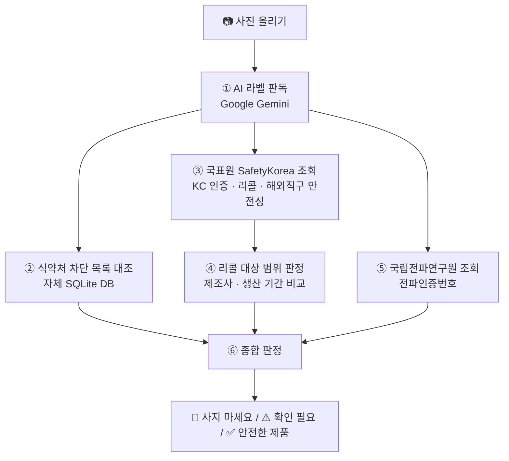

# 🛡️ 사진 한 장 안심체크

> **사기 전에, 쓰기 전에 사진 한 장으로 안심 체크!**
> 제품 사진을 올리면 AI가 라벨을 읽고 정부 공공데이터와 비교해 **들여와도 되는지, 써도 안전한지, 리콜 대상은 아닌지** 쉬운 말로 알려주는 대국민 서비스입니다.

| 구분 | 내용 |
|---|---|
| 🌐 **접속 주소** | **https://customs-safety-checker.streamlit.app/** |
| 🏢 만든 곳 | 광주세관 |
| 🤝 활용 데이터 | 관세청 · 식품의약품안전처 · 국가기술표준원 · 국립전파연구원 공공데이터 |
| 💰 이용 조건 | 무료 · 회원가입 없음 · PC와 휴대폰 모두 사용 가능 |

---

## 목차

1. [이런 분께 필요해요](#1-이런-분께-필요해요)
2. [주요 기능](#2-주요-기능)
3. [이용 방법 (국민 사용자)](#3-이용-방법-국민-사용자)
4. [동작 방식 (판정 흐름)](#4-동작-방식-판정-흐름)
5. [결과 화면 읽는 법](#5-결과-화면-읽는-법)
6. [관리자 화면](#6-관리자-화면)
7. [실행 방법](#7-실행-방법)
8. [환경 변수 (API 키)](#8-환경-변수-api-키)
9. [프로젝트 구조](#9-프로젝트-구조)
10. [데이터 출처](#10-데이터-출처)
11. [알아두실 점 (한계와 주의사항)](#11-알아두실-점-한계와-주의사항)
12. [신고 · 상담 전화](#12-신고--상담-전화)

---

## 1. 이런 분께 필요해요

- 해외직구나 해외여행에서 **영양제·약**을 사려는데, 우리나라에 들여와도 되는지 궁금한 분
- 아이에게 줄 **장난감·유아용품**이 안전 기준을 지켰는지 확인하고 싶은 분
- 집에 있는 **보조배터리·충전기**가 리콜 대상인지 알고 싶은 분
- 영어 라벨이나 복잡한 성분표를 읽기 어려운 분

---

## 2. 주요 기능

### 2-1. 📷 사진으로 바로 확인하기 (핵심 기능)

| 항목 | 내용 |
|---|---|
| 올릴 수 있는 사진 | JPG · JPEG · PNG · WEBP, **여러 장 동시에** 올리기 가능 |
| 휴대폰 카메라 | 화면에서 바로 찍어서 추가 가능 (`📱 휴대폰 카메라로 바로 찍기`) |
| AI가 읽는 내용 | 제품 이름(영문·한글), 브랜드, **제조사, 제조년월**, 바코드, 성분 목록, **KC 인증번호**, **전파인증번호(R-REM-… 등)**, 제품 종류 |
| 비교하는 정부 자료 | 식약처 해외직구 차단 목록, 국표원 KC 인증·국내/국외 리콜·해외직구 안전성 조사, 국립전파연구원 적합성평가 |
| 결과 | 🚫 사지 마세요 / ⚠️ 확인 필요 / ✅ 안전한 제품 중 하나로 한눈에 표시 |
| 근거 제공 | 내 사진과 정부 등록 사진 나란히 비교, "왜 안 되나요? · 몸에 어떤 영향이 있나요? · 어떻게 하면 되나요?" 문답형 설명 |
| 사진 지우기 | `🗑️ 올린 사진 모두 지우기`로 올린 파일과 카메라 사진을 한 번에 지움 |

### 2-2. 확인할 수 있는 4가지 주제

| 주제 | 이런 질문에 답해요 | 확인 내용 | 근거 자료 |
|---|---|---|---|
| 💊 **해외 약·영양제** | 먹어도 괜찮은 약일까요? | 반입 금지 성분 포함 여부, 처방전 필요 성분(멜라토닌 등), 차단 목록 등재 여부 | 식약처 해외직구 위해식품 차단 목록(약 5,055건) |
| 🧸 **어린이 제품** | 우리 아이가 써도 될까요? | KC 인증 상태, 리콜 이력, **표시사항(사용연령·체중 등) 이상 여부** | 국표원 SafetyKorea, AI 표시사항 판독 |
| 🧴 **생활용품** | 매일 쓰는 물건, 안전할까요? | KC 인증, 국내·국외 리콜, 해외직구 안전성 조사 부적합 이력 | 국표원 SafetyKorea |
| 🔌 **전기용품** | 불나거나 감전될 걱정은요? | KC 안전인증, **전파인증**, 리콜 대상 여부(제조사·생산 기간까지 비교) | 국표원 SafetyKorea, 국립전파연구원 |

### 2-3. 🔎 리콜 대상 범위 자동 판정

같은 인증번호·모델이라도 리콜은 **특정 제조사·특정 생산 기간** 제품에만 해당되는 경우가 많습니다.
이 서비스는 리콜 공고 문구에서 **대상 제조사 / 제외 제조사 / 생산 기간**을 읽고, 사진 라벨의 **제조사·제조일**과 자동으로 비교합니다.

> **예시** – 보조배터리 리콜 공고(인증번호 XU103167-25017)
> "리콜 대상은 … 제조자가 *Dongguan Ganna Electronic Technology Co., Ltd.*로 표기된 **2025년 7월~12월 생산분**에 한합니다. *Huizhou Ligao Cheng Electronics Co., Ltd.* 표기 제품은 리콜 대상이 아닙니다."

| 라벨 정보 | 판정 |
|---|---|
| Huizhou Ligao Cheng 제조, 2026년 5월 | ✅ 리콜 대상 아님 → **안전한 제품** |
| Dongguan Ganna 제조, 제조년월 "별도 표시" | ⚠️ **대상인지 확인 필요** (생산 시기가 2025년 7~12월이면 대상이라고 안내) |
| Dongguan Ganna 제조, 2025년 9월 | 🚫 **리콜 대상** |
| 제조사를 읽지 못함 | ⚠️ 확인 필요 (공고의 대상 범위 문장을 함께 보여줌) |

### 2-4. 🔍 직접 찾아보기 (사진 없이 검색)

사진이 없어도 제품 이름이나 인증번호로 직접 찾을 수 있습니다.

| 탭 | 찾는 방법 | 결과 |
|---|---|---|
| 💊 약·영양제 | 제품 이름·성분·바코드·회사 이름 검색, 또는 제품 이름+성분 직접 입력 비교 | 식약처 차단 목록 일치 여부, 막힌 이유, 제품 사진 |
| ✅ KC 안전인증 | 전체 / 제품 이름 / 모델명 / 인증번호 | 인증 상태(적합 등), 제조사·수입사, 인증 사진, 제품안전정보센터 원문 링크 |
| 🔌 전기제품 전파인증 | 인증번호(R-REM-…, MSIP-…, KCC-…) | 정식 인증 여부, 회사·모델·인증일, 같이 인증된 모델, 원문 링크 |
| 🚨 리콜(회수) 제품 | 🇰🇷 우리나라 / 🌍 해외 선택 후 제품 이름·모델명·바코드·인증번호·브랜드 | 문제 내용, 사고 위험, 조치 방법, 리콜 사진, 원문 링크 |
| 📦 해외직구 위험 제품 | 제품 이름 / 모델명 | 정부가 알리·테무 등에서 직접 사서 검사한 결과 중 유해물질 기준 초과 제품 |

### 2-5. ⚙️ 관리자 화면

오른쪽 위 `🔒 관리자` 버튼 → 비밀번호 로그인 후 사용합니다. 자세한 내용은 [6. 관리자 화면](#6-관리자-화면)을 참고하세요.

---

## 3. 이용 방법 (국민 사용자)

### 3-1. 사진으로 확인하기

1. **https://customs-safety-checker.streamlit.app/** 에 접속합니다.
2. `① 제품 사진 올리기`에서 **Upload**를 눌러 사진을 고르거나, 사진을 끌어다 놓습니다.
   - 휴대폰이라면 `📱 휴대폰 카메라로 바로 찍기`를 펼쳐 바로 찍고 **[찍은 사진 추가하기]**를 누릅니다.
3. **[🔍 안전한지 확인하기]** 버튼을 누릅니다.
4. 10~40초 정도 기다리면 `② 확인 결과`에 판정이 나옵니다.
5. 결과 아래의 **사진 비교**, **자세히 보기**, **왜 안 되나요?** 설명을 확인합니다.
6. 다른 제품을 확인하려면 **[🗑️ 올린 사진 모두 지우기]**를 누르고 처음부터 다시 합니다.

### 3-2. 정확도를 높이는 사진 찍기 요령

| 찍을 곳 | 왜 필요한가요 |
|---|---|
| **앞면** (제품 이름) | 제품 이름·브랜드로 차단 목록과 비교 |
| **뒷면** (성분표·Supplement Facts) | 금지·주의 성분 확인 |
| **옆면** (바코드) | 바코드가 일치하면 가장 정확하게 판정 |
| **표시사항 라벨** (KC 마크·인증번호, 제조사, 제조년월) | KC 인증 조회, 리콜 대상 범위 비교 |

- 글자가 잘 보이도록 **밝은 곳에서 가까이** 찍어 주세요.
- **여러 장**을 함께 올리면 AI가 모두 합쳐서 읽기 때문에 더 정확합니다.
- 리콜 공고는 **제품 본체 라벨** 기준인 경우가 많습니다. 상자와 본체 라벨이 다를 수 있으니 가능하면 본체 라벨도 찍어 주세요.

---

## 4. 동작 방식 (판정 흐름)



### ① AI 라벨 판독 (`services/ai_vision_service.py`)

- 올린 사진을 모두 합쳐 **Google Gemini 멀티모달 AI**에 보냅니다.
  - 사용 모델 순서: `gemini-2.5-flash` → (실패 시) `gemini-1.5-flash` → `gemini-2.0-flash`
- AI는 아래 항목을 JSON으로 돌려줍니다.
  - `product_name`, `brand`, `maker_name`(제조사), `manufacture_date`(제조년월), `barcode`, `ingredients`(성분), `harmful_suspects`(주의 성분), `kc_cert_num`, `rra_cert_nums`, `category`(제품 종류), `why_prohibited_reason`, `health_risks`, `customs_advice`
- 지시문에는 **오늘 날짜(한국 시간)**가 함께 들어가, 지난 제조일을 미래 날짜로 잘못 판단하지 않도록 합니다.
- 약·식품 성분만 `harmful_suspects`에 넣고, 어린이·생활·전기용품의 표시 오류는 설명 칸에 쓰도록 안내합니다.

### ② 식약처 차단 목록 대조 (`services/db_service.py`)

식품안전나라 Open API(I2715)에서 받아 둔 **자체 SQLite DB(`data/customs_safety.db`)**와 순서대로 비교합니다.

| 순서 | 비교 방법 | 결과 |
|---|---|---|
| 1순위 | **바코드 일치** | 🚫 위험 (DANGER) |
| 2순위 | **제품 이름 일치** | 🚫 위험 |
| 3순위 | **위해 성분 검출** (요힘빈·센나·실데나필 등) | 🚫 위험 또는 ⚠️ 주의 |
| 4순위 | AI가 주의 성분을 찾은 경우 | 약·식품 → ⚠️ 처방전·수량 확인 / 그 밖의 제품 → ⚠️ 제품 표시 확인 |
| 5순위 | 해당 없음 | 차단 목록에 없음 (PASS) |

### ③ 국표원 SafetyKorea 조회 (`services/safetykorea_api.py`)

- **KC 인증번호가 있으면** 인증번호로 KC 인증 상태와 국내 리콜을 바로 조회합니다.
  - 인증 상태가 `안전인증취소`, `안전확인신고 효력상실`, `기간만료`, `개선명령`이면 위험으로 판정합니다.
- **제품 이름·모델명·바코드로** 해외직구 안전성 조사 부적합, 국내 리콜, 국외 리콜을 함께 찾습니다.
- 리콜 상세 정보(문제 내용, 사고 위험, 조치 방법, 리콜 사진)를 추가로 불러옵니다.

### ④ 리콜 대상 범위 판정 (`services/recall_scope.py`)

- 리콜 공고 문구에서 회사 이름(`… Co., Ltd.` 등)을 찾고, 뒤에 "대상이 아닙니다", "제외" 같은 말이 있으면 **제외 제조사**로 분류합니다.
- "2025년 7월~2025년 12월 생산분" 같은 **생산 기간**을 읽습니다.
- 라벨의 제조사·제조일과 비교해 각 리콜을 `in_scope`(대상) / `out_of_scope`(대상 아님) / `check`(확인 필요)로 표시합니다.
- **실제 대상(in_scope)인 리콜만 위험으로 계산**하고, 확인이 필요한 리콜은 주의로 계산합니다.
- 공고에 조건이 없으면 같은 모델 전체를 리콜 대상으로 봅니다.

### ⑤ 국립전파연구원 조회 (`services/rra_api.py`)

- AI가 읽은 전파인증번호(`R-REM-…`, `R-RRI-…`, `MSIP-…`, `KCC-…`)로 국립전파연구원 적합성평가 정보를 조회합니다.
- 회사·모델명·인증일·제조국·같이 인증된 모델을 보여 줍니다.

### ⑥ 종합 판정 (`app.py`)

위에서부터 먼저 맞는 결과 하나를 보여 줍니다.

| 우선순위 | 조건 | 화면 표시 |
|---|---|---|
| 1 | 식약처 차단(DANGER), KC 인증 취소·효력상실, **대상에 해당하는 리콜**, 해외직구 안전성 부적합 | 🚫 **사지 마세요! 위험한 제품이에요** |
| 2 | 같은 모델 리콜이 있으나 대상인지 판단 불가 | ⚠️ **같은 모델이 리콜됐어요. 내 제품이 대상인지 확인해 주세요** |
| 3 | 약·식품이 아닌 제품의 표시사항 이상 | ⚠️ **잠깐! 제품 표시를 확인해 주세요** |
| 4 | 처방전 필요·수량 제한 성분 | ⚠️ **잠깐! 꼭 확인이 필요해요** |
| 5 | 위 어디에도 해당하지 않음 | ✅ **안전한 제품이에요** + 확인한 항목 체크 표시 |

✅ 결과에는 무엇을 확인했는지 함께 보여 줍니다.
`✔ KC 안전인증 정상(적합)` · `✔ 리콜 대상 아님` 또는 `✔ 리콜(회수) 이력 없음` · `✔ 정부 위험 제품·차단 목록에 없음`

---

## 5. 결과 화면 읽는 법

| 영역 | 내용 |
|---|---|
| **한눈에 보는 결과** | 맨 위 색깔 상자 (빨강 🚫 / 노랑 ⚠️ / 초록 ✅) |
| **내 사진과 정부 등록 사진 비교** | 왼쪽: 내가 올린 사진, 오른쪽: 식약처 차단 제품 사진 · 리콜 제품 사진 · KC 인증 등록 사진 중 하나 |
| **🔍 자세히 보기** | 왼쪽: AI가 사진에서 읽은 내용, 오른쪽: 정부 자료와 비교한 결과(문제 성분, 안 되는 이유, 판단 근거, 자료 출처, 라벨의 제조사·제조일) |
| **안내 카드** | ❓ 왜 안 되나요? · 🩺 몸에 어떤 영향이 있나요? · 👉 어떻게 하면 되나요? |
| **리콜 카드** | 🔎 내 제품은 대상일까요? · 📌 리콜 대상 범위(공고 원문) · 리콜 사진 · 정부 리콜 안내문 원문 링크 |
| **KC 안전인증 확인** | 인증번호, 인증 상태, 인증 기관·날짜, 인증 등록 사진, 제품안전정보센터 링크 |
| **📡 전파인증 확인** | 정식 인증 여부와 국립전파연구원 원문 링크 |

---

## 6. 관리자 화면

오른쪽 위 **`🔒 관리자`** 버튼을 누른 뒤 관리자 비밀번호로 로그인합니다. (비밀번호는 운영자에게 문의)

| 탭 | 기능 |
|---|---|
| 🔄 DB 업데이트 & 동기화 센터 | 식품안전나라 Open API에서 차단 목록 **전체를 다시 받아 자체 DB 갱신** |
| ⚡ 시스템 상태 & API 연동 | 식약처·국표원·전파연구원·Gemini 연결 상태 확인, 응답 속도 테스트 |
| 📊 데이터 총 건수 및 통계 현황 | 차단 데이터 수, 바코드 수, 위해 성분 종류 수, 마지막 동기화 시각 |
| 📋 실시간 사용 현황 및 검사 이력 | 현재 접속 중 검사한 제품, 판정, 소요 시간 |

왼쪽 메뉴의 `🔑 AI 비전 엔진(Gemini) 설정`에서 Gemini API 키를 바꿀 수 있습니다. (로그인 후에만 보입니다)

---

## 7. 실행 방법

### 7-1. 운영 (Streamlit Community Cloud)

- 접속 주소: **https://customs-safety-checker.streamlit.app/**
- GitHub `main` 브랜치에 푸시하면 Streamlit Cloud가 **자동으로 다시 배포**합니다. (보통 1~2분)
- API 키는 Streamlit 앱 설정의 **Secrets**에 넣습니다.

```toml
# Streamlit Cloud → App settings → Secrets
GEMINI_API_KEY = "발급받은 키"
FOOD_SAFETY_API_KEY = "발급받은 키"
FOOD_SAFETY_SERVICE_ID = "I2715"
SAFETYKOREA_API_KEY = "발급받은 키"
```

> 다시 배포되면 접속 중인 사용자의 화면이 새로 시작되어 올린 사진이 지워집니다.

### 7-2. 내 PC에서 실행 (Streamlit)

**준비물**: Python 3.11 이상 (개발 컨테이너 기준 3.11), Git

```bash
# 1. 소스 받기
git clone https://github.com/bslee1129/customs-safety-checker.git
cd customs-safety-checker

# 2. 가상환경 만들기 (권장)
python -m venv .venv
# Windows
.venv\Scripts\activate
# macOS / Linux
source .venv/bin/activate

# 3. 필요한 패키지 설치
pip install -r requirements.txt

# 4. API 키 설정 (.env.example을 복사해서 키 입력)
# Windows
copy .env.example .env
# macOS / Linux
cp .env.example .env

# 5. 실행
streamlit run app.py
```

브라우저에서 **http://localhost:8501** 이 열립니다.

- 화면 테마(밝은 화면, 파란 강조색)는 `.streamlit/config.toml`에 있습니다.
- `.streamlit/secrets.toml`에 키를 넣어도 됩니다. (`.gitignore`로 저장소에는 올라가지 않음)
- 키를 읽는 순서: **시스템 환경변수 → `.env` → Streamlit Secrets** (`config.py`의 `get_secret`)

### 7-3. 식약처 차단 목록 DB 갱신

관리자 화면의 `🔄 DB 업데이트 & 동기화 센터`를 쓰거나, 명령어로 실행합니다.

```bash
python sync_food_safety_db.py
```

식품안전나라 Open API(I2715)에서 1,000건씩 전부 받아 `data/customs_safety.db`를 **통째로 교체**합니다.

### 7-4. (선택) FastAPI 웹 서버 · REST API

Streamlit 화면과 별도로, 같은 기능을 REST API와 단일 웹페이지(`templates/index.html`)로 제공하는 서버도 들어 있습니다.

```bash
python server.py
# 또는
uvicorn server:app --host 0.0.0.0 --port 8000
```

브라우저에서 **http://localhost:8000** 에 접속합니다.

| 메서드 | 주소 | 기능 |
|---|---|---|
| GET | `/` | 웹 화면 |
| POST | `/api/inspect/photo` | 사진 검사 |
| POST | `/api/inspect/text` | 제품 이름·성분 입력 검사 |
| GET | `/api/drugs` | 식약처 차단 목록 검색 |
| GET | `/api/stats` | DB 통계 |
| GET | `/api/sync/status` · POST `/api/sync/fetch` · POST `/api/sync/all` | 식품안전나라 동기화 |
| GET | `/api/safetykorea/cert` · `/cert-detail` · `/recall/domestic` · `/recall/foreign` · `/overseas` · `/comprehensive` | 국표원 조회 |
| GET | `/api/rra/cert` | 전파인증 조회 |
| GET | `/api/image/local/{seq}` | 저장된 차단 제품 사진 |

---

## 8. 환경 변수 (API 키)

| 이름 | 필수 | 설명 | 발급처 |
|---|---|---|---|
| `GEMINI_API_KEY` | ✅ | 사진 라벨 판독 AI | Google AI Studio (aistudio.google.com) |
| `FOOD_SAFETY_API_KEY` | DB 갱신 시 | 식약처 해외직구 위해식품 차단 목록 | 식품안전나라 Open API |
| `FOOD_SAFETY_SERVICE_ID` | | 서비스 ID (기본값 `I2715`) | |
| `SAFETYKOREA_API_KEY` | ✅ | KC 인증, 리콜, 해외직구 안전성 조사 | 제품안전정보센터(SafetyKorea) Open API |
| `HOST` / `PORT` / `DEBUG` | | FastAPI 서버 설정 (기본 `0.0.0.0` / `8000` / `True`) | |

> 국립전파연구원 조회는 별도 키 없이 공개 조회 페이지를 사용합니다.
> API 키는 절대 GitHub에 올리지 마세요. `.env`, `.streamlit/secrets.toml`은 `.gitignore`에 등록되어 있습니다.

---

## 9. 프로젝트 구조

```
customs-safety-checker/
├── app.py                     # Streamlit 화면 (국민 화면 + 관리자 화면) ← 운영 서비스
├── config.py                  # 환경 변수·Secrets 읽기, 경로 설정
├── server.py                  # (선택) FastAPI 서버 + REST API
├── sync_food_safety_db.py     # 식품안전나라 차단 목록 전체 받아서 DB 갱신
├── requirements.txt           # 필요한 패키지
├── .env.example               # 환경 변수 예시
├── .streamlit/
│   └── config.toml            # 화면 테마 (밝은 화면, 파란 강조색)
├── data/
│   ├── customs_safety.db      # 식약처 해외직구 차단 목록 자체 DB (SQLite)
│   └── drugs_db_cache.json    # 보조 캐시
├── services/
│   ├── ai_vision_service.py   # Gemini 사진 라벨 판독
│   ├── db_service.py          # 차단 목록 검색·1~5순위 대조 판정
│   ├── food_safety_api.py     # 식품안전나라 Open API (I2715)
│   ├── safetykorea_api.py     # 국표원 KC 인증·리콜·해외직구 안전성 조회
│   ├── recall_scope.py        # 리콜 대상 범위(제조사·생산 기간) 판정
│   └── rra_api.py             # 국립전파연구원 전파인증 조회
├── static/                    # FastAPI 웹 화면용 CSS·JS·이미지
└── templates/
    └── index.html             # FastAPI 웹 화면
```

---

## 10. 데이터 출처

| 기관 | 데이터 | 이 서비스에서 쓰는 곳 |
|---|---|---|
| 식품의약품안전처 (식품안전나라) | 해외직구 위해식품 차단 정보 (Open API I2715) | 약·영양제 차단 목록 대조 |
| 국가기술표준원 (제품안전정보센터 SafetyKorea) | KC 인증 정보, 국내 리콜, 국외 리콜, 해외직구 안전성 조사 결과 | 어린이·생활·전기용품 확인 |
| 과학기술정보통신부 국립전파연구원 | 방송통신기자재 적합성평가(전파인증) | 전기·전자제품 전파인증 확인 |
| 관세청 | 해외직구 통관 기준 (자가사용 인정 기준 등) | 안내 문구 |
| Google Gemini | 멀티모달 AI | 사진 속 글자·라벨 판독 |

---

## 11. 알아두실 점 (한계와 주의사항)

- **참고용 서비스입니다.** 최종 통관 여부와 안전 판단은 세관 및 관계 기관의 결정에 따릅니다.
- AI가 사진을 **잘못 읽을 수 있습니다.** 흐리거나 기울어진 사진, 일부만 보이는 라벨은 결과가 달라질 수 있습니다.
- AI가 쓴 설명 문장(왜 안 되나요? 등)은 표현이 단정적일 수 있으니, 근거 자료(차단 목록 일치, 리콜 공고 원문)를 함께 확인해 주세요.
- 리콜 대상 범위 자동 판정은 공고가 "제조자가 ○○ Co., Ltd.로 표기된 ○년 ○월~○년 ○월 생산분" 같은 형식일 때 잘 동작합니다. 형식이 다른 공고는 **"대상인지 확인해 주세요"**로 안내합니다.
- 올린 사진은 판독을 위해 **Google Gemini API로 전송**됩니다. 개인정보(얼굴, 주소 등)가 찍히지 않게 주의해 주세요.
- 식약처 차단 목록은 자체 DB에 저장된 시점 기준입니다. 최신 상태를 유지하려면 관리자 화면에서 주기적으로 동기화하세요.
- 운영 개선 권장: 관리자 비밀번호를 코드가 아닌 **Streamlit Secrets로 옮겨** 관리하는 것을 권장합니다.

---

## 12. 신고 · 상담 전화

| 내용 | 전화 (국번 없이) |
|---|---|
| 불량식품·약 신고 (식약처) | **1399** |
| 제품 안전 상담 (KC 인증, 제품안전정보센터) | **1600-1384** |
| 밀수 신고 (관세청) | **125** |

---

### 저장소

- GitHub: https://github.com/bslee1129/customs-safety-checker
- GitLab: https://gitlab.aigov.go.kr/bslee1129/customs-safety-checker
